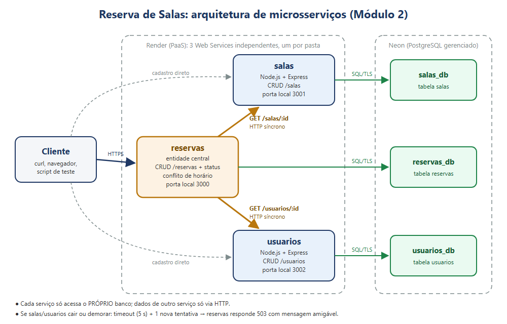

# 🏫 Reserva de Salas: Microsserviços

Projeto incremental da disciplina **Sistemas Distribuídos** (UERN, 3ª unidade).

> **Entrega atual: Módulo 2, Serviços / Microsserviços.** A API do Módulo 1 foi dividida em **3 microsserviços independentes** (salas, usuários e reservas), cada um com seu próprio código, seu próprio banco e seu próprio deploy. Eles se comunicam via **HTTP/REST síncrono**.

| | |
|---|---|
| 🌐 **Reservas** (entrada principal) | https://reservas-salas-api.onrender.com |
| 🌐 **Salas** | https://servico-salas.onrender.com |
| 🌐 **Usuários** | https://servico-usuarios.onrender.com |
| 🎥 **Vídeo do Módulo 2** | https://drive.google.com/file/d/1Z5bWpSyRRnSwUiyd7bfVDBEq_yD49Dxc/view?usp=sharing |
| 🎥 **Vídeo do Módulo 1** | https://drive.google.com/file/d/1nra5iK1i0fpFXBGh57rVP6sTLAbB59ck/view?usp=sharing |
| 🏷️ **Tag da entrega** | `entrega-2-microsservicos` (anterior: `entrega-1-cloud`) |

---

## 1. Domínio

Sistema de **reserva de salas** (laboratórios, auditórios, salas de reunião). A entidade central continua sendo a **Reserva**, que agora referencia uma **Sala** e um **Usuário** cadastrados em outros serviços.

**Fluxo de estados da reserva** (sem mudança desde o Módulo 1):

```
PENDENTE ──► CONFIRMADA
    │             │
    └──► CANCELADA ◄┘
```

A transição para **CONFIRMADA** é o evento que será publicado via RabbitMQ no Módulo 4.

---

## 2. Arquitetura



*(versão vetorial: [`docs/arquitetura.svg`](docs/arquitetura.svg))*

| Serviço | Responsabilidade (contexto do domínio) | Banco próprio | Depende de |
|---|---|---|---|
| **salas** | Cadastro das salas: nome, capacidade, localização, ativa/inativa | `salas_db` | ninguém |
| **usuarios** | Cadastro de quem reserva: nome, email, tipo (ALUNO, PROFESSOR, SERVIDOR) | `usuarios_db` | ninguém |
| **reservas** | Reservas, regra de conflito de horário e mudança de status | `reservas_db` | salas, usuarios (HTTP) |

### Como os serviços conversam

1. O cliente faz `POST /reservas` com `sala_id` e `usuario_id`.
2. O serviço de **reservas** chama, **em paralelo**, `GET /salas/:id` e `GET /usuarios/:id`.
3. Com a resposta:
   - sala ou usuário **não existe** (404 do outro serviço) → reservas responde **422**;
   - sala **inativa** → **422**;
   - tudo certo → checa conflito de horário no próprio banco (**409** se houver) e grava (**201**).
4. `GET /reservas/:id` devolve a reserva **já com os dados da sala e do usuário**, buscados nos outros serviços (composição de dados via API).

### Tratamento de falha do serviço dependente

O enunciado pede "tratamento básico de erro quando o serviço dependente está indisponível". Implementado em [`services/reservas/src/clientes.js`](services/reservas/src/clientes.js):

| Situação | O que acontece |
|---|---|
| Serviço **fora do ar** (conexão recusada) | 1 nova tentativa após 500 ms e, se falhar de novo, **503** com `"O serviço de salas está indisponível no momento. Tente novamente em instantes."` |
| Serviço **lento/travado** | Cada chamada tem **timeout** (`HTTP_TIMEOUT_MS`, padrão 5 s). Estourou: nova tentativa e depois **503**. A requisição nunca fica pendurada para sempre. |
| `GET /reservas/:id` com um serviço fora | **Degradação graciosa:** a reserva volta (200) com `"sala": null` e um campo `avisos` explicando o motivo. |
| `PATCH /status`, `GET /reservas`, `DELETE` | Não dependem dos outros serviços: continuam funcionando mesmo com salas/usuarios fora. |
| `GET /health` de reservas | Mostra o estado do próprio banco **e** dos serviços de que ele depende. |

Exemplo real (serviço de salas derrubado):

```
$ curl -X POST localhost:3000/reservas -H "Content-Type: application/json" -d '{"sala_id":3,"usuario_id":2,...}'
{"erro":"O serviço de salas está indisponível no momento. Tente novamente em instantes.","servico":"salas"}   ← HTTP 503

Log do serviço de reservas:
[reservas -> salas] tentativa 1/2 falhou: ECONNREFUSED
[reservas -> salas] tentativa 2/2 falhou: ECONNREFUSED
[reservas] Serviço de salas indisponível (ECONNREFUSED). Respondendo 503.
```

### Justificativa das escolhas

| Decisão | Por quê |
|---|---|
| **Divisão em salas / usuarios / reservas** | Cada serviço cuida de um contexto do domínio com dados próprios. Salas e usuários mudam pouco e são consultados por reservas; reservas concentra a regra de negócio (conflito, status). |
| **Um banco por serviço** (*database per service*) | Nenhum serviço lê a tabela de outro. Isso garante independência: dá para mudar o esquema de salas sem quebrar reservas, e cada serviço pode ser publicado ou escalado sozinho. O preço é não ter chave estrangeira entre bancos: a integridade é verificada **via HTTP** antes de gravar. |
| **HTTP/REST síncrono** | Pedido pelo enunciado. Para validar uma reserva, reservas *precisa* da resposta na hora (a sala existe?), então a chamada síncrona faz sentido aqui. No Módulo 4 o evento "reserva confirmada" será **assíncrono** (RabbitMQ), porque quem consome não precisa responder na hora. |
| **`fetch` nativo + `AbortSignal.timeout`** | O Node 22 já traz um cliente HTTP. Não precisamos instalar `axios` e mantemos as dependências mínimas (só `express` e `pg`). |
| **Timeout + 1 nova tentativa + 503** | Em sistema distribuído a rede falha. Sem timeout, uma requisição pode ficar presa indefinidamente; com 1 nova tentativa absorvemos falhas momentâneas, e o 503 diz claramente ao cliente que o problema é temporário. |
| **Chamadas em paralelo (`Promise.all`)** | Salas e usuários são consultados ao mesmo tempo, então a latência total é a do mais lento, não a soma dos dois. |
| **`GET /reservas` (listagem) não busca sala/usuário** | Listar N reservas geraria 2N chamadas HTTP (problema "N+1"). O detalhe completo fica no `GET /reservas/:id`. |
| **Monorepo com uma pasta por serviço** | Permitido pelo enunciado. Cada pasta tem seu próprio `package.json`, e no Render cada Web Service usa a sua como *Root Directory*. Não há código compartilhado entre os serviços: um pouco de repetição é o preço da independência. |
| **URLs dos outros serviços em variáveis de ambiente** | `SALAS_URL` e `USUARIOS_URL` mudam entre local e nuvem sem mudar o código (12-factor). |

---

## 3. Endpoints

### Serviço de salas (`:3001` local)
| Método | Rota | Descrição | Respostas |
|---|---|---|---|
| `GET` | `/health` | Serviço e banco no ar | 200 / 503 |
| `GET` | `/salas` | Lista (filtro `?ativa=true\|false`) | 200 |
| `GET` | `/salas/:id` | Busca uma sala (**usado por reservas**) | 200 / 404 |
| `POST` | `/salas` | Cria `{nome, capacidade, localizacao?, ativa?}` | 201 / 400 / 409 |
| `PUT` | `/salas/:id` | Atualiza | 200 / 400 / 404 / 409 |
| `DELETE` | `/salas/:id` | Remove | 204 / 404 |

### Serviço de usuários (`:3002` local)
| Método | Rota | Descrição | Respostas |
|---|---|---|---|
| `GET` | `/health` | Serviço e banco no ar | 200 / 503 |
| `GET` | `/usuarios` | Lista (filtro `?tipo=`) | 200 |
| `GET` | `/usuarios/:id` | Busca um usuário (**usado por reservas**) | 200 / 404 |
| `POST` | `/usuarios` | Cria `{nome, email, tipo}` | 201 / 400 / 409 |
| `PUT` | `/usuarios/:id` | Atualiza | 200 / 400 / 404 / 409 |
| `DELETE` | `/usuarios/:id` | Remove | 204 / 404 |

### Serviço de reservas (`:3000` local)
| Método | Rota | Descrição | Respostas |
|---|---|---|---|
| `GET` | `/health` | Banco + estado de salas e usuarios | 200 / 503 |
| `GET` | `/reservas` | Lista (filtros `?sala_id=`, `?usuario_id=`, `?status=`) | 200 |
| `GET` | `/reservas/:id` | Reserva **com dados da sala e do usuário** | 200 / 404 |
| `POST` | `/reservas` | Cria `{sala_id, usuario_id, inicio, fim}` | 201 / 400 / 409 / 422 / **503** |
| `PUT` | `/reservas/:id` | Atualiza | 200 / 400 / 404 / 409 / 422 / **503** |
| `PATCH` | `/reservas/:id/status` | Muda o status | 200 / 400 / 404 |
| `DELETE` | `/reservas/:id` | Remove | 204 / 404 |

---

## 4. Como executar localmente

Pré-requisitos: **Node.js 22+** e um PostgreSQL com **3 bancos**: `salas_db`, `usuarios_db` e `reservas_db`. Pode ser um Postgres local ou os 3 bancos do Neon (ver 5.1).

```bash
git clone https://github.com/emilhomes/reservas-salas-api.git
cd reservas-salas-api
npm run install:all          # instala as dependências dos 3 serviços

# Crie o .env de cada serviço a partir do exemplo e preencha a DATABASE_URL de cada um
cp services/salas/.env.example    services/salas/.env
cp services/usuarios/.env.example services/usuarios/.env
cp services/reservas/.env.example services/reservas/.env

npm run dev                  # sobe os 3 serviços com logs coloridos por serviço
```

Saída esperada:

```
[salas   ] Serviço de SALAS rodando na porta 3001
[usuarios] Serviço de USUÁRIOS rodando na porta 3002
[reservas] Serviço de RESERVAS rodando na porta 3000
[reservas]   -> salas:    http://localhost:3001
[reservas]   -> usuarios: http://localhost:3002
```

Também dá para subir cada serviço sozinho, em terminais separados: `cd services/salas && npm run dev`.

---

## 5. Deploy em nuvem

### 5.1 Bancos: Neon
No mesmo projeto do Módulo 1, em **Databases → New Database**, crie `salas_db`, `usuarios_db` e `reservas_db`. A *connection string* de cada um é a mesma do Módulo 1, trocando só o nome do banco no final (`.../salas_db?sslmode=verify-full`).

> O banco antigo (`neondb`) fica intocado, preservando a entrega do Módulo 1. Se o serviço de reservas for apontado por engano para ele, o serviço **se recusa a subir** e explica o motivo (a tabela antiga não tem `sala_id`).

### 5.2 Serviços: Render (3 Web Services, mesmo repositório)

| Web Service | Root Directory | Build / Start | Variáveis de ambiente |
|---|---|---|---|
| salas *(novo)* | `services/salas` | `npm install` / `npm start` | `DATABASE_URL` (salas_db) |
| usuarios *(novo)* | `services/usuarios` | `npm install` / `npm start` | `DATABASE_URL` (usuarios_db) |
| reservas *(o do Módulo 1, reconfigurado)* | `services/reservas` | `npm install` / `npm start` | `DATABASE_URL` (reservas_db), `SALAS_URL`, `USUARIOS_URL`, `HTTP_TIMEOUT_MS=15000`, `HTTP_TENTATIVAS=4` |

Passo a passo:
1. **New + → Web Service** → mesmo repositório → *Root Directory* `services/salas` → plano Free → variável `DATABASE_URL`. Repita para `services/usuarios`.
2. No serviço `reservas-salas-api` (Módulo 1): **Settings → Root Directory** = `services/reservas`. Em **Environment**, troque `DATABASE_URL` para o `reservas_db` e adicione `SALAS_URL` e `USUARIOS_URL` com as URLs públicas dos dois serviços novos. Assim a URL pública do Módulo 1 continua valendo.
3. Faça o deploy dos três.

> ⚠️ **Cold start em cadeia.** No plano Free cada serviço adormece sozinho após ~15 min. Se reservas acordar e chamar salas dormindo, essa chamada pode levar ~50 s. Por isso, na nuvem usamos `HTTP_TIMEOUT_MS=15000` e `HTTP_TENTATIVAS=4` (até ~1 min de espera), e o script de teste acorda os três serviços antes de começar. Localmente o padrão é 5 s × 2 tentativas.

---

## 6. Testes

### Painel de demonstração (interface web)

```bash
npm run painel                # abre em http://localhost:4000 (testa a nuvem ou serviços locais já rodando)
npm run painel -- --local     # também sobe os 3 serviços locais e permite derrubar/religar cada um
```

O painel não tem dependências e não altera os serviços: um pequeno servidor Node ([`scripts/painel.js`](scripts/painel.js)) entrega a página ([`painel/index.html`](painel/index.html)) e repassa as requisições para os serviços (os serviços não têm CORS, então o navegador não fala com eles diretamente). Ele mostra:

- **Diagrama ao vivo:** cada requisição anima as setas entre cliente, reservas, salas e usuários, e cada serviço tem um indicador de saúde (`/health`).
- **"O que aconteceu":** a explicação passo a passo de quem chamou quem e por que veio aquele código HTTP.
- **Roteiro da apresentação:** 12 passos com o resultado esperado (201, 409, 422, 503...) e a conferência automática: saúde, cadastro em cada serviço, reserva validada via HTTP, composição de dados, conflito, sala/usuário inexistente, sala inativa, confirmação, **falha de serviço dependente** e limpeza.
- **Abas de CRUD** de cada serviço, o histórico de requisições (corpo enviado e resposta) e, com `--local`, os **logs reais** dos 3 processos, com as chamadas `reservas -> salas/usuarios` destacadas.

> Na nuvem, para demonstrar a falha, suspenda o `servico-salas` no Render (**Settings → Suspend Web Service**) e depois reative. Localmente, com `--local`, basta clicar em **Derrubar salas**.

### Script de ponta a ponta (20 verificações)

```bash
# local
npm run test:api

# nuvem
npm run test:api -- --reservas https://reservas-salas-api.onrender.com \
                    --salas    https://servico-salas.onrender.com \
                    --usuarios https://servico-usuarios.onrender.com
```

✅ **Resultado na nuvem (04/11/2026):** 20/20 verificações passaram nas URLs públicas acima.

O script acorda os 3 serviços, cria sala e usuário e então testa reserva criada (201), conflito (409), sala inexistente (422), usuário inexistente (422), sala inativa (422), detalhe com dados compostos, listagem, PUT, PATCH, health com dependências e limpeza.

### Testando a falha de um serviço (tratamento de erro)

1. Com os 3 serviços rodando, pare **só o de salas** (Ctrl+C no terminal dele, ou suspenda o serviço no painel do Render).
2. Tente criar uma reserva:
   ```bash
   curl -i -X POST http://localhost:3000/reservas -H "Content-Type: application/json" \
     -d '{"sala_id":1,"usuario_id":1,"inicio":"2026-11-12T08:00:00-03:00","fim":"2026-11-12T10:00:00-03:00"}'
   ```
   → `HTTP 503` + mensagem amigável.
3. `curl http://localhost:3000/reservas/1` → `200`, com `"sala": null` e `avisos`.
4. `curl http://localhost:3000/health` → `"dependencias": {"salas": "indisponível (ECONNREFUSED)", "usuarios": "ok"}`.
5. Suba salas de novo: tudo volta a funcionar **sem reiniciar reservas**.

### Comandos curl (fluxo feliz)

```bash
curl -X POST localhost:3001/salas -H "Content-Type: application/json" \
  -d '{"nome":"Laboratório 01","capacidade":30,"localizacao":"Bloco B"}'

curl -X POST localhost:3002/usuarios -H "Content-Type: application/json" \
  -d '{"nome":"Maria","email":"maria@uern.br","tipo":"PROFESSOR"}'

curl -X POST localhost:3000/reservas -H "Content-Type: application/json" \
  -d '{"sala_id":1,"usuario_id":1,"inicio":"2026-11-10T14:00:00-03:00","fim":"2026-11-10T16:00:00-03:00"}'

curl localhost:3000/reservas/1        # reserva + dados da sala + dados do usuário

curl -X PATCH localhost:3000/reservas/1/status -H "Content-Type: application/json" -d '{"status":"CONFIRMADA"}'
```

---

## 7. Estrutura do projeto

```
├── services/
│   ├── salas/
│   │   ├── src/index.js       # servidor, /health, tratamento de erros
│   │   ├── src/db.js          # conexão com salas_db + criação da tabela
│   │   ├── src/salas.js       # CRUD de salas
│   │   ├── package.json
│   │   └── .env.example
│   ├── usuarios/              # mesma estrutura (usuarios.js)
│   └── reservas/
│       ├── src/index.js       # servidor, /health com dependências, erro 503
│       ├── src/db.js          # conexão com reservas_db + criação da tabela
│       ├── src/reservas.js    # CRUD, conflito, validação via outros serviços
│       ├── src/clientes.js    # cliente HTTP: timeout, nova tentativa, 503
│       ├── package.json
│       └── .env.example
├── scripts/
│   ├── dev.js                 # sobe os 3 serviços localmente
│   ├── painel.js              # servidor do painel de demonstração (proxy + logs ao vivo)
│   └── testar-api.js          # teste de ponta a ponta (local ou nuvem)
├── painel/index.html          # interface web para testar e apresentar os serviços
├── docs/
│   ├── arquitetura.svg / .png # diagrama
│   └── prints/                # evidências
├── package.json               # só scripts de conveniência (sem dependências)
├── CHANGELOG.md
└── README.md
```

## 8. Roadmap

- [x] **Módulo 1:** Computação em Nuvem (`entrega-1-cloud`)
- [x] **Módulo 2:** Microsserviços: salas, usuarios, reservas (esta entrega)
- [ ] **Módulo 3:** Containers (um Dockerfile por serviço + docker-compose com os 3 bancos)
- [ ] **Módulo 4:** Mensageria (evento "reserva confirmada" via RabbitMQ)
